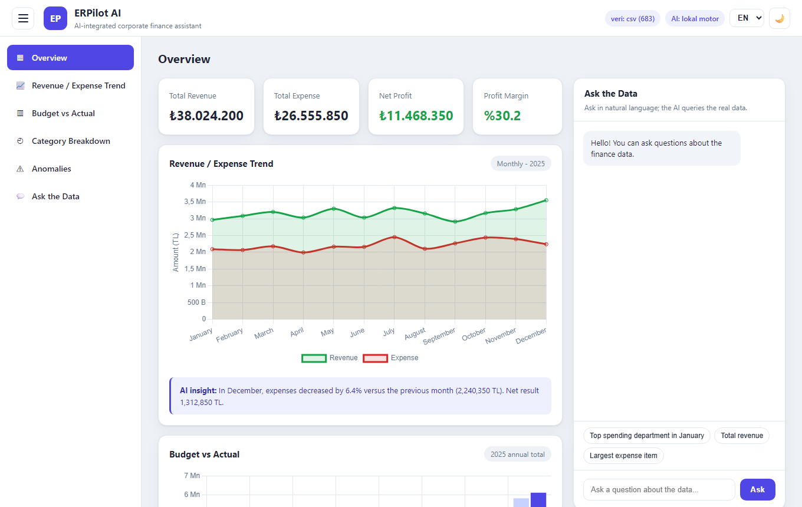
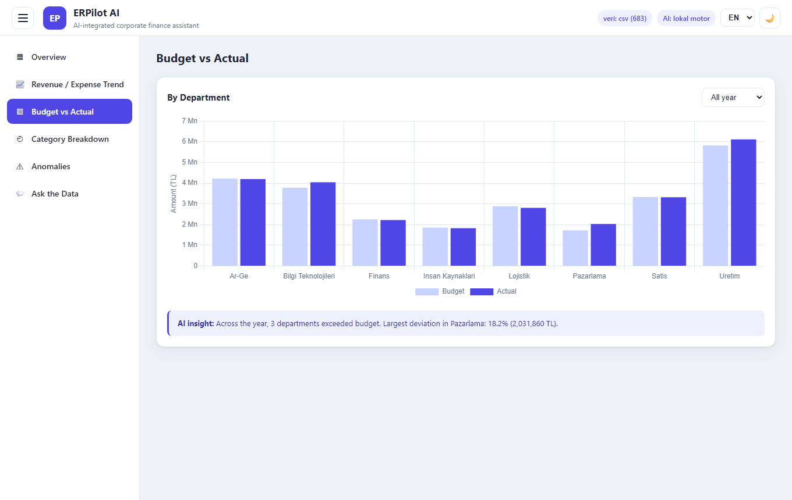
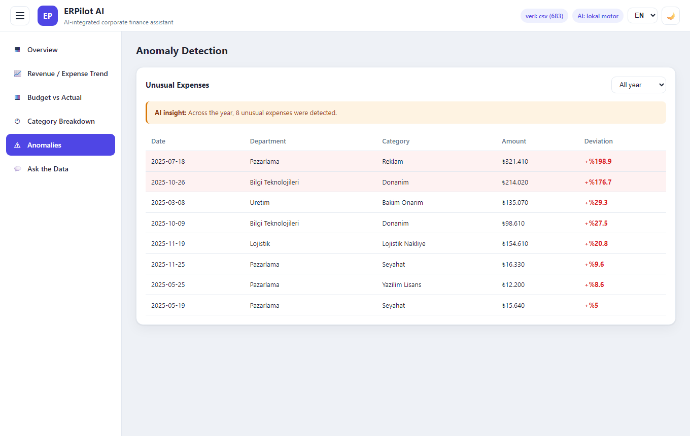
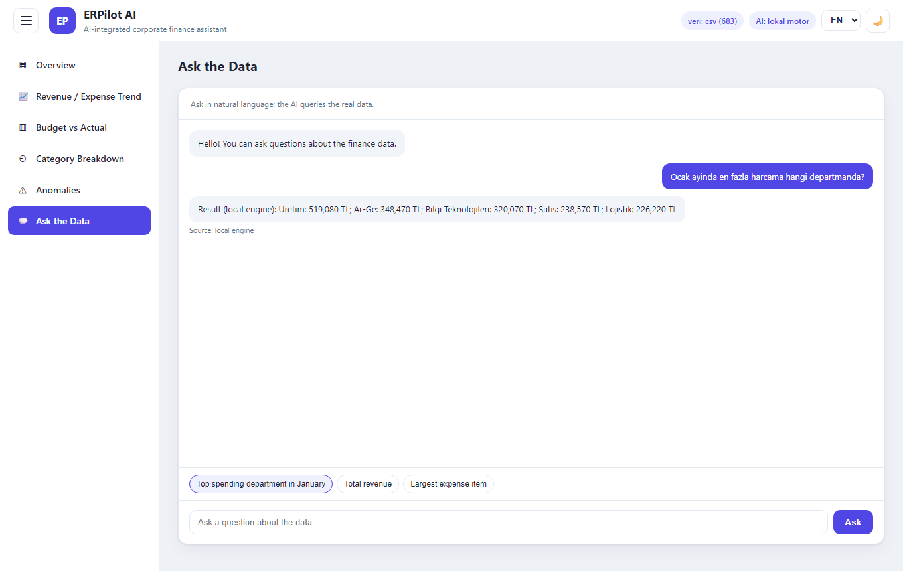
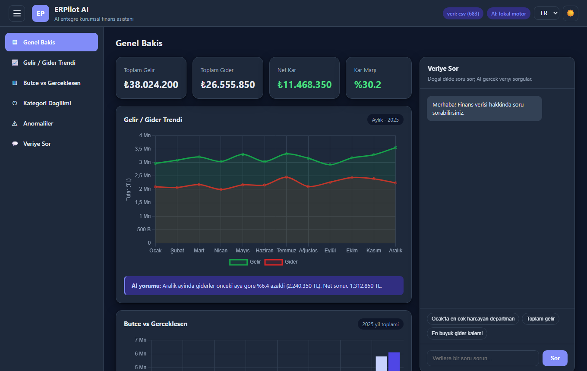
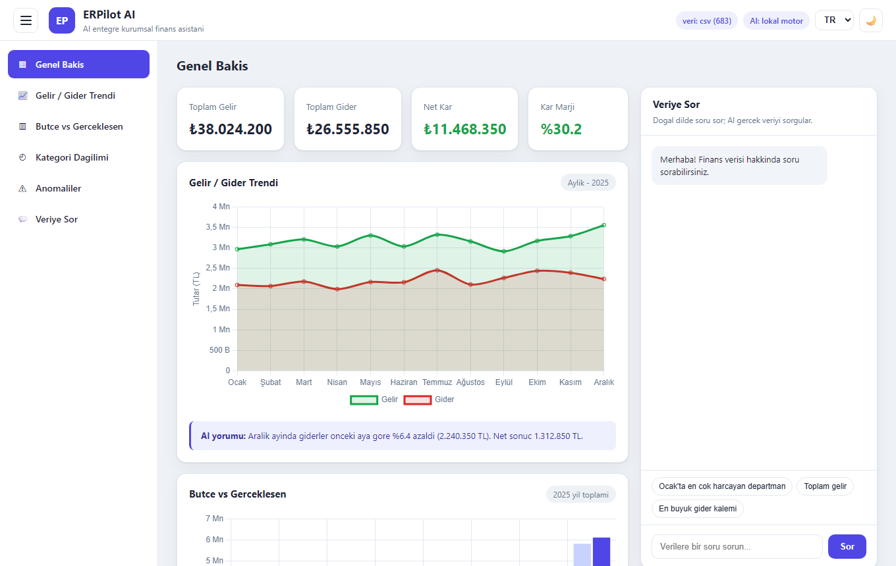
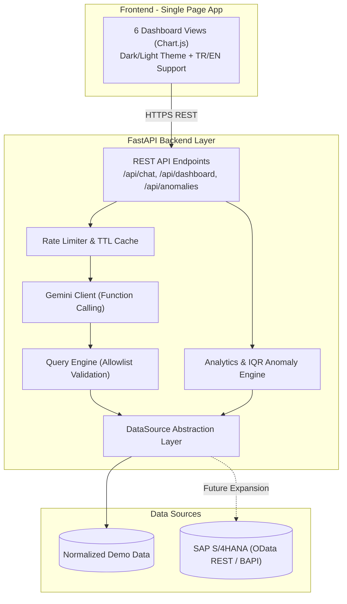
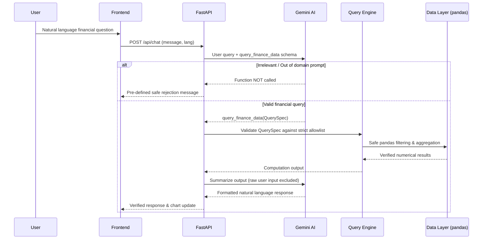

# ERPilot AI — Product & Architecture Showcase 🤖📊

**English** | [Türkçe](README.tr.md)

**A natural language financial assistant and anomaly detection platform for enterprise data. Built for the BTK Academy Hackathon 2026 (Finance Category).**

Ask questions in plain language ("Which department spent the most in January?"); the system queries verified financial data, generates interactive charts, provides concise AI commentary, and highlights statistical outliers.

> ℹ️ **About This Showcase:**  
> This repository is a **public product showcase and technical portfolio**. The full application source code (FastAPI backend, query engine, and prompt guardrail layers) is kept in a private repository. This repository contains the system architecture, sequence diagrams, and UI screenshots.

---

## 📸 Screenshots & UI Walkthrough

| Overview Dashboard (Revenue, Expenses, Profit & Natural Language Chat) | Budget vs Actual Spend |
|---|---|
|  |  |

| Outlier / Anomaly Detection (IQR Method) | Ask the Data (Function-Calling NL Querying) |
|---|---|
|  |  |

| Dark Theme | Turkish Localization |
|---|---|
|  |  |

---

## 🎯 Key Engineering Highlights

- **Ask the Data (Natural Language Querying):** Google Gemini converts unstructured queries into a structured `QuerySpec`. Numbers are calculated from underlying data, preventing hallucination.
- **Secure Architecture (Zero SQL/Code Injection):** The model never writes raw SQL or executable code. It only populates strict Pydantic `Literal` allowlists. Irrelevant or adversarial prompts are rejected at the architectural layer.
- **Statistical Anomaly Detection:** Outlier expenses exceeding normal thresholds are flagged automatically using the Interquartile Range (IQR) method.
- **AI Commentary & Persistent Caching:** Generates concise explanations for each chart. When an API key is absent, an offline deterministic engine generates insights from the same calculations.
- **Bilingual & Dual Theme:** Turkish and English language support with seamless dark/light theme switching.

---

## 🏗️ System Architecture

### "Ask the Data" Execution Flow (Function Calling + Guardrail Security)

---

## 💻 Tech Stack

| Layer | Technology |
|---|---|
| **Backend** | Python, FastAPI, Pydantic, pandas, NumPy, SlowAPI |
| **Artificial Intelligence** | Google Gemini (Function Calling / Structured Outputs), Offline Rule Engine |
| **Frontend** | Vanilla JavaScript, Chart.js, HTML5, CSS3, Modern Responsive Layout |
| **Data Architecture** | Normalized Schemas, CSV (SAP S/4HANA OData Ready) |
| **Documentation** | [docs/ARCHITECTURE.md](docs/ARCHITECTURE.md) · [docs/DEMO.md](docs/DEMO.md) · [docs/pitch.md](docs/pitch.md) |

---

## 🔒 Source Code Notice

This repository does not contain application source code, database files, or API credentials. It is published purely as an architectural case study and product showcase.
