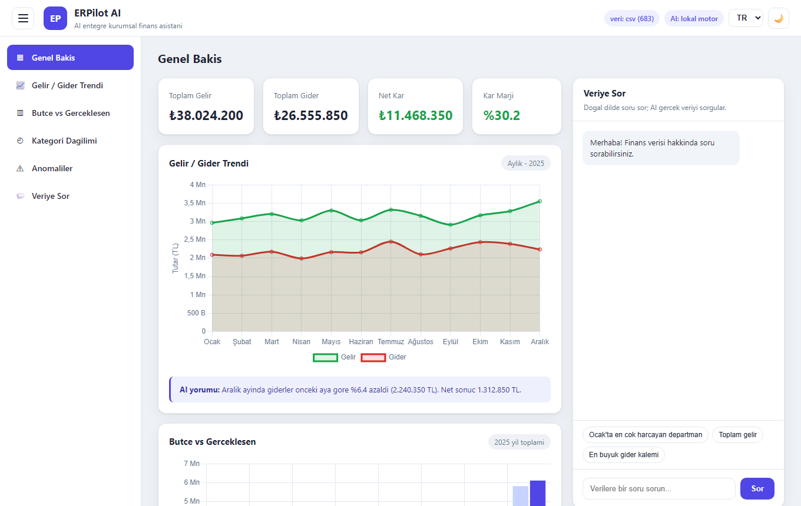
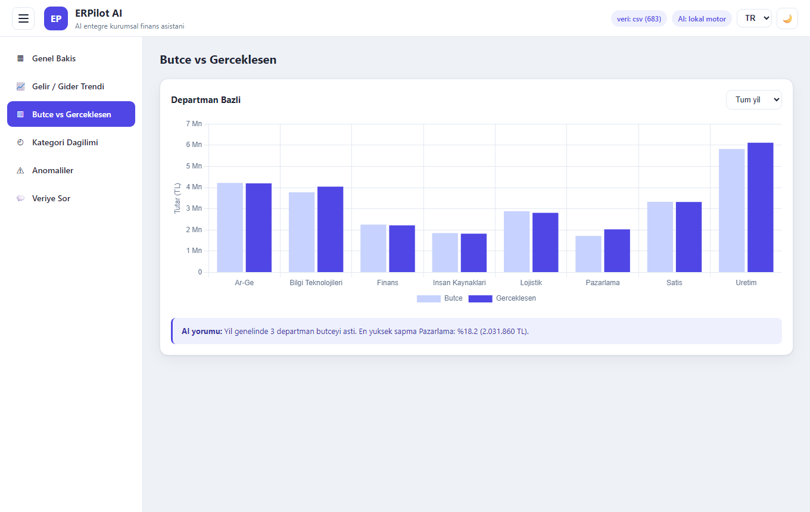
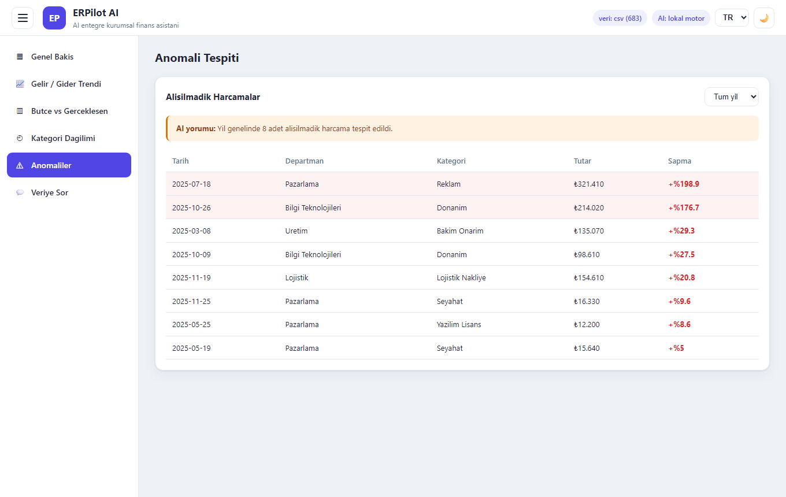
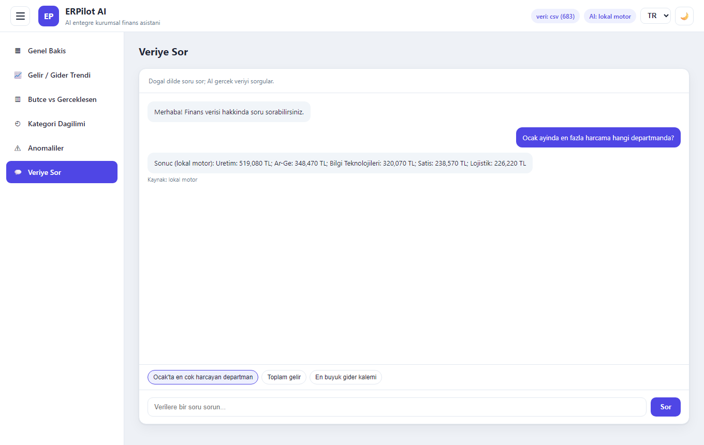
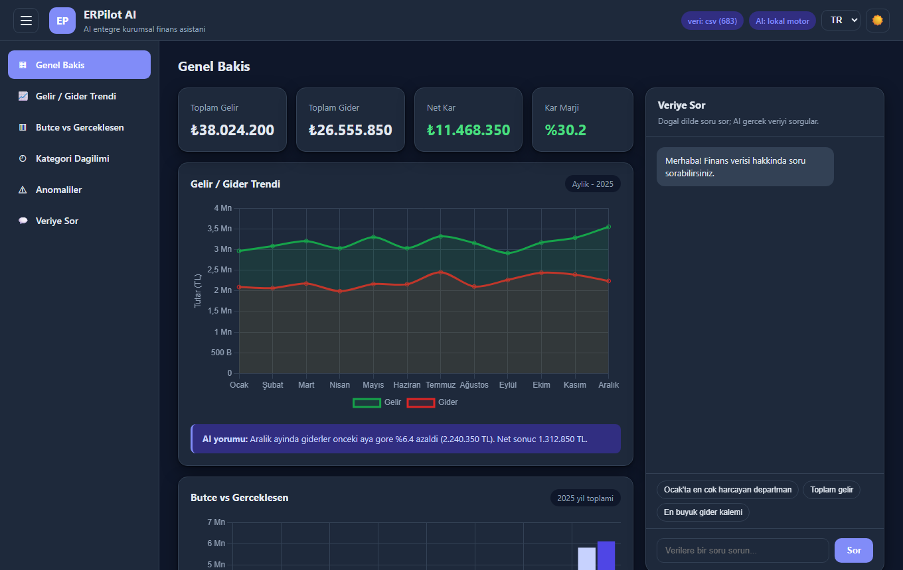
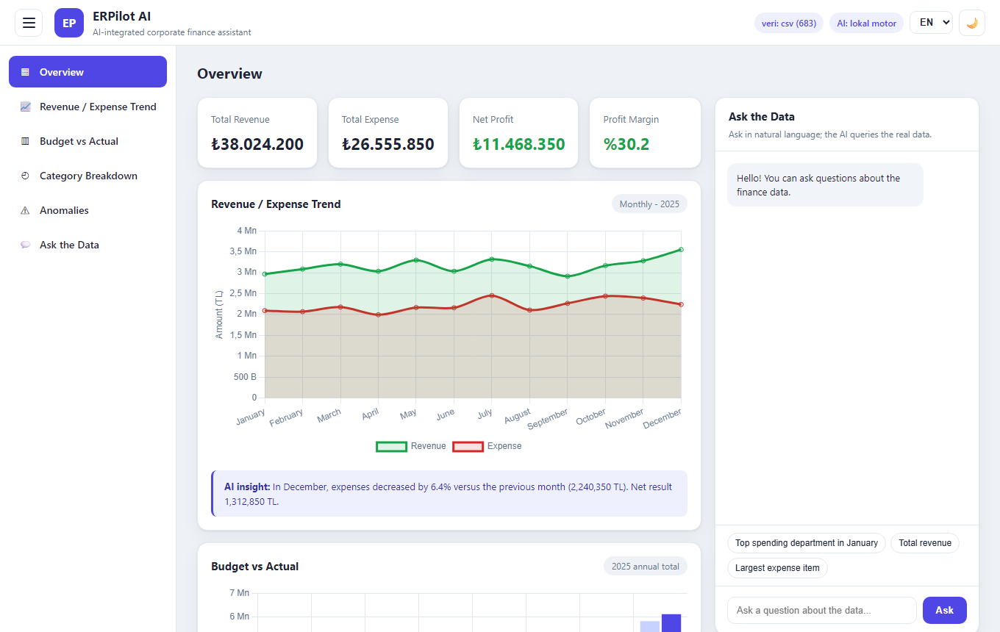
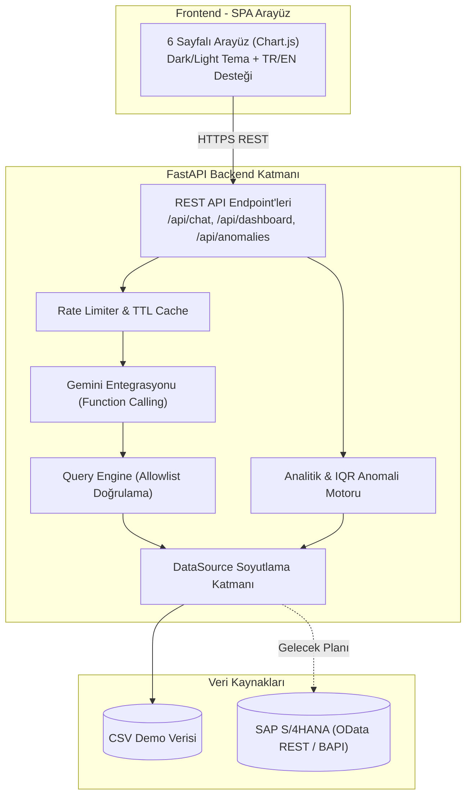
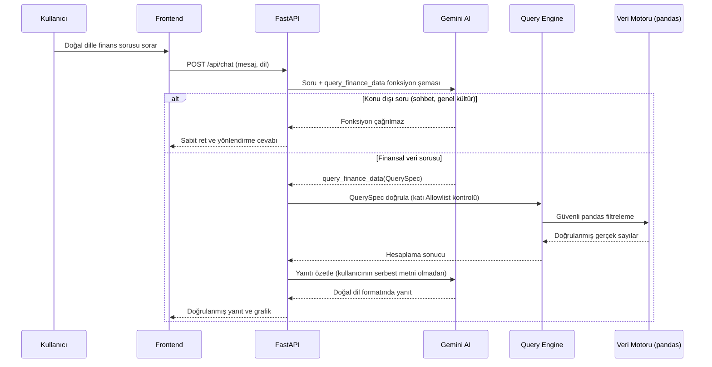

# ERPilot AI — Ürün ve Mimari Vitrini 🤖📊

[English](README.md) | **Türkçe**

**Şirketler için yapay zekâ destekli finans asistanı ve anomali tespit platformu. BTK Akademi Hackathon 2026 finans kategorisi için geliştirilmiştir.**

Sorunuzu doğal dille sorarsınız ("Ocak'ta en çok hangi departman harcadı?"); sistem gerçek finansal veriyi sorgular, grafiklerini çizer, her grafiğe anında yorum yazar ve olağandışı harcamaları işaretler.

> ℹ️ **Bu Vitrin Hakkında:**  
> Bu depo **ürün tanıtımı ve teknik portföy** içindir. Uygulama kaynak kodları (FastAPI backend, veri sorgulama motoru ve prompt guardrail katmanları) ayrı bir **private** depoda tutulur. Bu depoda sistem mimarisi, akış şemaları ve arayüz ekran görüntüleri yayımlanmaktadır.

---

## 📸 Ekran Görüntüleri ve Arayüz Turu

| Genel Bakış (Gelir, Gider, Kâr ve Veriyle Sohbet) | Bütçe ve Gerçekleşen Harcamalar |
|---|---|
|  |  |

| Alışılmadık Harcamalar (IQR Anomali Tespiti) | Veriye Sor (Doğal Dil ile Finansal Sorgulama) |
|---|---|
|  |  |

| Koyu Tema (Dark Mode) | İngilizce Arayüz |
|---|---|
|  |  |

---

## 🎯 Öne Çıkan Özellikler

- **Veriye Sor (Natural Language Querying):** Google Gemini modeli soruyu yapısal bir sorgu nesnesine (`QuerySpec`) çevirir; sayılar modelin halüsinasyonundan değil, doğrulanmış gerçek veriden gelir.
- **Güvenli Tasarım (Zero SQL/Code Injection):** Model asla doğrudan SQL veya Python kodu yazamaz; yalnızca backend'in kontrol ettiği katı `allowlist` kalıplarını doldurur. Konu dışı veya enjeksiyon amaçlı sorular mimari düzeyde reddedilir.
- **Anomali Tespiti (Outlier Detection):** Normal dağılım aralığının dışındaki harcamalar IQR (Interquartile Range) istatistiksel yöntemiyle anında tespit edilir ve kırmızıyla işaretlenir.
- **Yapay Zekâ Yorumları & Kalıcı Önbellek:** Her grafiğin altında kısa analitik açıklamalar üretilir. Gemini API anahtarı olmadığında dahi yerel deterministik motor aynı hesaplamalarla yorum yazar.
- **Çoklu Dil & Tema:** Türkçe ve İngilizce dil desteği, açık ve koyu tema seçenekleri.

---

## 🏗️ Sistem Mimarisi

### "Veriye Sor" Akışı (Function Calling + Guardrail Güvenliği)

---

## 💻 Kullanılan Teknolojiler

| Katman | Teknoloji |
|---|---|
| **Backend** | Python, FastAPI, Pydantic, pandas, NumPy, SlowAPI |
| **Yapay Zekâ** | Google Gemini (Function Calling / Structured Outputs), Yerel Deterministik Yorum Motoru |
| **Arayüz (Frontend)** | Vanilla JavaScript, Chart.js, HTML5, CSS3, Modern Responsive Layout |
| **Veri Kaynağı** | Normalize Veri Modelleri, CSV (Gelecekte SAP S/4HANA OData Entegrasyonu) |
| **Mimari Dokümanları** | [docs/ARCHITECTURE.md](docs/ARCHITECTURE.md) · [docs/DEMO.md](docs/DEMO.md) · [docs/pitch.md](docs/pitch.md) |

---

## 🔒 Kaynak Kodu Bildirimi

Bu depoda uygulamanın kaynak kodları, veri tabanı modelleri veya API anahtarları **bulunmaz**. Depo yalnızca mimari inceleme ve teknik vitrin niteliğindedir.
